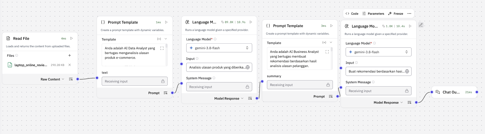
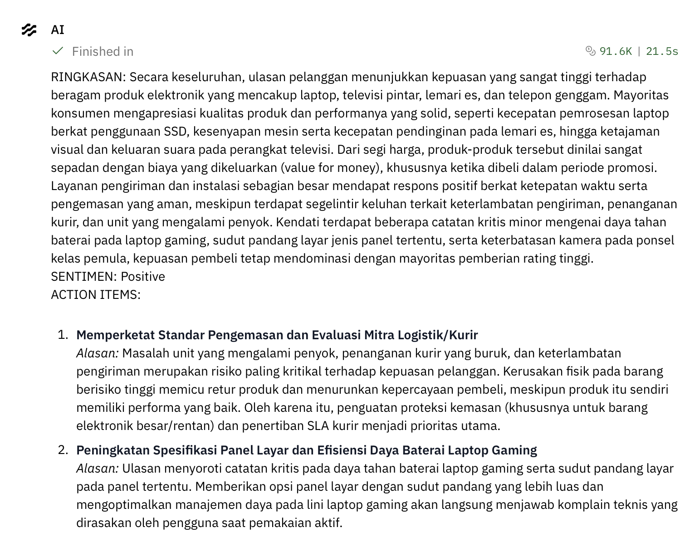

# Customer Feedback Sentiment Analysis with Langflow

A visual AI workflow that turns customer product reviews into an Indonesian-language summary, an overall sentiment label, and prioritized business recommendations. Built in **Langflow** using two **Google Gemini** language-model steps.

## Project overview

The workflow separates review analysis from recommendation generation. The first model summarizes the supplied reviews and identifies the overall sentiment. The second model uses that analysis to propose actions and explain their priorities.

**Tools:** Langflow, Google Generative AI / Gemini, prompt templates, and file-based review input.

**Deliverables:** an importable Langflow JSON export, a workflow screenshot, and a captured example response. The source review dataset is not included.

## Workflow



The screenshot shows the six connected components used in this project:

| Step | Component | Purpose |
| --- | --- | --- |
| 1 | Read File | Read the uploaded customer-review file as raw content. |
| 2 | Prompt Template | Insert the reviews into the analyst prompt through `{text}`. |
| 3 | Language Model | Generate a coherent summary and an overall Positive, Neutral, or Negative sentiment label. |
| 4 | Prompt Template | Insert the first model’s response into the business-analysis prompt through `{summary}`. |
| 5 | Language Model | Generate prioritized recommendations with supporting reasons. |
| 6 | Chat Output | Display the final summary, sentiment, and action items. |

The prompt outputs connect to the models’ **System Message** inputs. Each model also has a short task instruction in its **Input** field. This is a sequential two-model workflow, not a separately trained sentiment classifier.

### Analysis and recommendation prompts

The first prompt asks for a single formal Indonesian paragraph discussing product quality, performance, price, delivery, and customer satisfaction when supported by the reviews. It requests an overall sentiment label and instructs the model not to invent facts.

The second prompt asks for the main issues, prioritized product or service improvements, and a reason for each recommendation. Its requested output contains `RINGKASAN`, `SENTIMEN`, and three `ACTION ITEMS`.

## Example output



In this captured run, the response:

- Describes generally positive feedback about electronic products, including performance, value for money, delivery, and installation.
- Labels the overall sentiment as **Positive**.
- Recommends strengthening packaging and evaluating logistics partners to address reported damage and delivery issues.
- Recommends improvements to display viewing angles and gaming-laptop battery efficiency based on the summarized complaints.

The screenshot contains the summary, sentiment, and the first two recommendations. It does not show the complete three-item response requested by the prompt. The interface reports approximately **21.5 seconds** and **91.6K tokens** for this particular run; these are observed UI values, not performance benchmarks or accuracy measurements. The original dataset is not included, so the screenshot’s conclusions cannot be independently checked from this repository alone.

## Input data

The exported prompt expects these columns:

| Column | Meaning |
| --- | --- |
| `Unnamed: 0` | Review identifier, as named in the original dataset |
| `Product_name` | Product name |
| `Review` | Customer review text |
| `Rating` | Rating from 1 to 5 |

Upload a review file whose contents can be read by your Langflow Read File component. If your column names differ, update the first prompt accordingly. The data should be provided by you; the export does not bundle the original uploaded file.

## Import and run

1. Open your Langflow installation. The JSON export records `last_tested_version: 1.12.0`; compatibility with other versions has not been tested here.
2. Import [`workflows/customer-feedback-sentiment-analysis.json`](workflows/customer-feedback-sentiment-analysis.json) as a flow.
3. In **Read File**, select or upload your own review dataset. Local upload references do not transfer between installations.
4. In **both Language Model components**, configure your Google Generative AI credentials and select a Gemini model available to your account and Langflow version. The supplied export and screenshot display `gemini-3.8-flash`; that saved label is not a guarantee of current model availability.
5. Review the two prompt templates and confirm the six nodes remain connected as shown above. Both exported model temperatures are `0.1`.
6. Run the flow and inspect the response in Chat Output / Playground.
7. Check the generated summary and recommendations against the source reviews before using them for business decisions.

Configure API keys inside your local Langflow environment. The exported API-key fields are empty. Do not commit credentials or private review datasets. Model calls may require billing and consume your provider quota.

## Scope and limitations

- Produces a **qualitative overall sentiment**, not per-review labels, class percentages, or validated sentiment accuracy.
- The second model relies on the first model’s summary rather than checking the original reviews again. Missing or inaccurate details can carry forward.
- The flow has no explicit chunking or batching stage. Large datasets may exceed model context limits or produce incomplete summaries.
- Prompt instructions reduce unsupported claims but do not guarantee factual correctness or a consistent output format. There is no structured-output validator in this export.
- File contents are inserted into a system-message prompt. Untrusted reviews may contain prompt-injection text; use trusted inputs for this demonstration and add input isolation and validation before broader use.
- This repository packages the owner-provided export and screenshots. The workflow was not rerun or evaluated during repository preparation.

## Repository contents

```text
workflows/
  customer-feedback-sentiment-analysis.json  # Langflow export
docs/images/
  workflow.png                              # Full workflow screenshot
  example-output.png                        # Captured result
README.md
.gitignore
```

The original export and screenshots are preserved without modification. Embedded component code is part of the Langflow export; this repository is not a standalone Python application.
